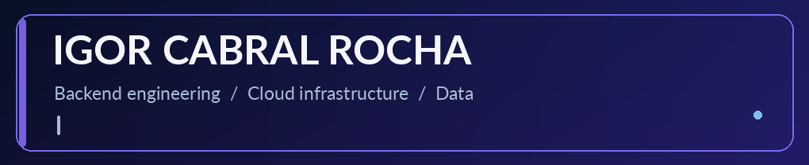
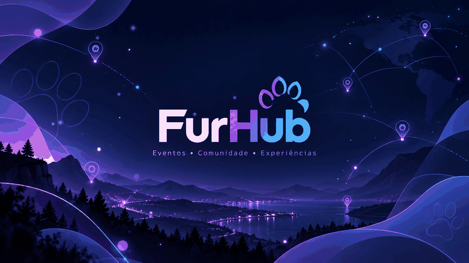

<!-- GitHub profile README: put this file in the repository igorrochalord/igorrochalord. -->

  

   

  **DevOps & Python Specialist at PUC-Rio · Creator of FurHub & Núcleo ERP**

  `Python` · `Infrastructure as Code` · `Terraform` · `Docker` · `CI/CD` · `AWS` · `GCP` · `Rust`

  

    
    
    
  

---

## 👨‍💻 About Me

I'm a **DevOps & Python engineer** focused on infrastructure as code, automation, reliable delivery pipelines, and backend services that keep running under pressure.

Currently a **DevOps & Python Specialist (Specialist I) at [PUC-Rio](https://www.puc-rio.br)**, where I work on Python automation and on the university's **infrastructure as code (IaC)**.

Outside my day job I build two products of my own:

- 🐾 **FurHub (FurCon Hub)** — event discovery and convention management for the furry fandom.
- 🧾 **Núcleo ERP** — an installable ERP for small businesses: sales, stock, finance and service orders, working **with or without internet**.

What I work with:

- ☁️ **DevOps & IaC:** Terraform, Docker, CI/CD (GitHub Actions, GitLab CI), AWS, GCP, Magalu Cloud
- 🐍 **Python & Backend:** FastAPI, Flask, APIs, automation, web scraping
- 🦀 **Desktop & systems:** Rust, Tauri, SQLite
- 📊 **Data:** ETL pipelines, PostgreSQL, MongoDB, analytics, real-time systems
- 🌐 **Languages:** Portuguese (native) · English (fluent)

---

## ⭐ Featured Projects

Two products I design and build end to end: one cloud-native for a community, one local-first for small businesses.

<table>
  <tr>
    <td width="50%" valign="top">
      <h3>🐾 FurHub</h3>
      
<b>Events · Community · Experiences</b>

      
SaaS for discovering furry events and helping convention organizers run them with less friction.

      
<code>Python</code> <code>FastAPI</code> <code>React</code> <code>PostgreSQL</code> <code>Redis</code> <code>Docker</code>

      

      
<a href="#-furhub"><b>Read more ↓</b></a>

    </td>
    <td width="50%" valign="top">
      <h3>🧾 Núcleo ERP</h3>
      
<b>Sales · Stock · Finance · Service orders</b>

      
Installable ERP for small businesses. Data stays on the company's computer; online integrations are optional.

      
<code>Rust</code> <code>Tauri v2</code> <code>React</code> <code>TypeScript</code> <code>SQLite</code> <code>GitHub Actions</code>

      

      
<a href="#-núcleo-erp"><b>Read more ↓</b></a>

    </td>
  </tr>
</table>

### 🐾 FurHub

  

**FurHub** is my community-focused SaaS initiative for helping people discover furry events and helping convention organizers work with less operational friction. The goal: **better events for attendees, artists, volunteers, fursuiters, and organizing teams.**

| Area | What FurHub aims to improve |
|:--|:--|
| 🗺️ **Event discovery** | Public event listings, interactive maps, nearby search, and schedules |
| 🎟️ **Convention management** | Registration, ticketing workflows, badges, and QR-based check-in |
| 🎨 **Artist Alley & Dealers Den** | Artist applications, portfolios, booths, and vendor coordination |
| 🐾 **Fursuit Care** | Cooling areas, rest spaces, hydration, and parade logistics |
| 🤝 **Volunteer support** | Shift planning, tasks, announcements, and less organizational overload |
| 🛡️ **Safety & accessibility** | Accessible event information, incident workflows, and privacy protections |
| 📊 **Data & insights** | Attendance dashboards, event finances, operational indicators, and reports |
| 💜 **Community experience** | Fursona profiles, digital passes, event agendas, and optional achievements |

**My role:** creator, software architect, and lead developer across backend, infrastructure, product design, and the event-management domain.

**Core technologies:** `Python` `FastAPI` `React` `JavaScript` `PostgreSQL` `Docker` `Redis` `Leaflet` `OpenStreetMap` `GitHub Actions`

> **Status:** in active development. Some capabilities above are on the roadmap and may not be in a public release yet.

### 🧾 Núcleo ERP

  

**Núcleo ERP** is a management system for small and mid-sized businesses (bakeries, shops, repair services) that **installs like any program**. No server and no cloud subscription: data stays on the company's computer, with automatic daily backups. It uses the internet for online services, but **keeps working offline**.

| Area | What it does |
|:--|:--|
| 🛒 **Sales & stock** | Cash or credit sales, cancellations that return stock, minimum-stock alerts |
| 💰 **Finance** | Payables and receivables, bank statements (OFX), cash flow, and income statement (DRE) |
| 🔧 **Service orders** | Kanban board, parts and services, one-click invoicing (sale + stock + finance in one transaction) |
| 📊 **Reports** | Dashboard, ABC curve, period comparison, Excel and PDF export |
| 🔌 **Online integrations** | Offline-tolerant job queue with retries and encrypted credentials; PIX, NFS-e and marketplaces next |
| 🛡️ **Security** | Role-based access, append-only audit log, Argon2 passwords |

**Engineering highlights:** Rust core with **70 automated tests**, SQLite with versioned migrations, CI building Windows (`.exe`/`.msi`) and Linux (`AppImage`/`.deb`/`.rpm`) installers on every release, and architecture decisions documented as ADRs.

**Core technologies:** `Rust` `Tauri v2` `React 19` `TypeScript` `SQLite` `GitHub Actions`

[**See the repository →**](https://github.com/Igorrochalord/Esteio) · [**Download the latest version →**](https://github.com/Igorrochalord/Esteio/releases/latest)

---

## 🚀 Engineering Impact

| Area | Result |
|:--|--:|
| Cloud cost reduction via Terraform + Magalu Cloud migration | **−35%** monthly cost |
| Docker pipeline optimization in hybrid AWS/GCP environments | **−60%** deployment time |
| Real-time election system uptime under extreme traffic | **99.9%** uptime |
| Web scraping portfolio (150+ active scrapers) | **98%** collection rate |
| Real-time audience bot serving the newsroom | **130+** simultaneous users |
| Deployment time reduction with CI/CD at Demander | **−75%** |
| Improvement in editorial decision-making agility | **+50%** |

---

## 🛠️ Tech Stack

### DevOps, IaC & Cloud

### Backend & Applications

### Data

---

## 💼 Professional Experience

### DevOps & Python Specialist (Specialist I) — [PUC-Rio](https://www.puc-rio.br)
`Octuber 2026 – Present` · Rio de Janeiro, Brazil

- Working on the university's **infrastructure as code (IaC)**, versioning and automating its environments.
- Building **Python** automation and tooling for DevOps workflows.

### Backend & DevOps Developer — [Poder360](https://poder360.com.br)
`Jun 2024 – Octuber 2026` · Brasília, Brazil

- Migrated infrastructure to Magalu Cloud using Terraform, reducing cloud costs by **35%**.
- Designed real-time election coverage systems with **99.9% uptime** under peak traffic.
- Built and maintained **150+ scrapers** with a **98%** collection success rate.
- Optimized Docker deployment pipelines, reducing delivery time by **60%**.
- Architected real-time financial quotes for Poder Mercado, contributing to **+23%** product engagement.
- Delivered a Google Partner project processing SIOP/Treasury data **30% faster**.

### Backend Developer — [Demander](https://demander.com.br)
`Dec 2023 – Apr 2024` · Lajeado, Brazil

- Containerized a legacy PHP/Laravel stack with Docker and GitLab CI/CD.
- Implemented internationalization for three languages.
- Optimized critical SQL queries for a **35%** performance gain.

### Backend Developer — LegalWtech
`Jul 2023 – Oct 2023` · São Paulo, Brazil

- Built legal automation processing **500+ documents/day**.
- Developed Rasa chatbots, improving automated service accuracy by **45%**.
- Provisioned Docker services on AWS with **99.5% uptime**.

---

## 📁 Other Projects

### [BotEconomy](https://github.com/igorrochalord)
Telegram bot for real-time financial-market analysis.  
`Python` `Pandas` `Matplotlib` `Docker` — Automated alerts, interactive charts, and PDF reports.

### [Document Manager](https://github.com/igorrochalord)
Full-stack web application with authentication and secure document storage.  
`Flask` `MongoDB` `Docker Compose` — Containerized infrastructure and role-based access control.

---

## 🎓 Education & Certifications

**Systems Analysis and Development** — Estácio de Sá University *(Nov 2024)*

`AWS IaC with Terraform` · `GCP AI Applications with Cloud Run` · `Advanced Docker` · `Terraform (Basic to Advanced)` · `Python Complete + RPA`

---

## 📈 GitHub Stats

  
  

---

**Always happy to talk about DevOps, infrastructure as code, Python, and building products end to end.**

🐾 *FurHub — technology for more connected, organized, and welcoming furry events.*  
🧾 *Núcleo ERP — simple business management, on your own computer, with or without internet.*

📧 **[igorprofessionaljob@gmail.com](mailto:igorprofessionaljob@gmail.com)**

